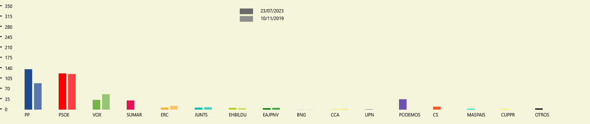

<div align="center">

# 🗳️ Pactómetro

**Aplicación de escritorio en WPF para visualizar y comparar resultados electorales y simular pactos de gobierno**

[]()
[]()
[]()
[]()

[Descripción](#-sobre-el-proyecto) · [Captura](#-captura) · [Funcionalidades](#-funcionalidades) · [Cómo ejecutarlo](#-cómo-ejecutarlo) · [Datos](#-formato-de-los-datos) · [Estructura](#-estructura-del-repositorio) · [Stack](#-stack-tecnológico)

</div>

---

## 📖 Sobre el proyecto

**Pactómetro** es una aplicación de escritorio que permite **introducir los resultados de unas elecciones** (generales o autonómicas), **verlos como gráficas de barras** y **compararlos con otras convocatorias**. Su parte más vistosa es el *pactómetro*: una gráfica interactiva en la que se arman coaliciones entre partidos para comprobar quién alcanza la **mayoría absoluta**.

> 📌 **Proyecto académico** desarrollado como trabajo final de la asignatura de *Interfaces Gráficas de Usuario* (curso 2023-2024, Universidad de Salamanca).

---

## 🖼️ Captura

<p align="center">
  
</p>

<p align="center"><em>Comparación de dos elecciones generales (23/07/2023 y 10/11/2019). Los ejes se ajustan solos a los escaños de la convocatoria.</em></p>

---

## ✨ Funcionalidades

- **Pantalla de carga animada** al abrir la aplicación.
- **Gráficas de barras dibujadas sobre un `Canvas`**, con ejes dinámicos según los escaños en juego (350 en las generales).
- **Ventana de datos no modal** para dar de alta, modificar y eliminar elecciones y partidos (nombre, escaños y color), sin bloquear la ventana principal.
- **Datos pre-cargados** desde un fichero de texto y opción de **guardar el estado** para próximas ejecuciones.
- Los partidos se **ordenan automáticamente por escaños**, de modo que las barras se leen de un vistazo.
- **Modo Comparación**: enfrenta los resultados de cada partido en distintas elecciones del mismo tipo (avisa si no hay suficientes para comparar).
- **Modo Pactómetro**: al pulsar un partido se mueve de una gráfica a otra para formar coaliciones; la gráfica izquierda muestra las combinaciones que superan la mayoría absoluta y un eje marca el umbral a alcanzar.
- **Exportar a PNG** la gráfica principal y **ventana de ayuda** integrada.

---

## 🚀 Cómo ejecutarlo

**Requisitos:** Windows y Visual Studio con la carga de trabajo *Desarrollo de escritorio con .NET* (.NET Framework 4.8).

1. Abre `El_Pactometro.sln` en Visual Studio.
2. Restaura los paquetes NuGet (`Extended.Wpf.Toolkit 4.5.1` y `WpfAnimatedGif 2.0.2`); Visual Studio lo hace al compilar.
3. Compila y ejecuta con **F5**. El fichero `datos/Partidos.txt` se copia junto al ejecutable automáticamente.

---

## 🗂️ Formato de los datos

`datos/Partidos.txt` contiene una convocatoria por línea, con los campos separados por `*`. Los resultados incluidos son datos electorales públicos.

| Tipo | Campos |
| :--- | :--- |
| **Generales** | `Elecciones Generales*fecha*escaños totales*` y después, por cada partido, `nombre*escaños*#color` |
| **Autonómicas** | `Elecciones Autonómicas*lugar*fecha*escaños totales*` y después, por cada partido, `nombre*escaños*#color` |

Ejemplo (recortado):

```text
Elecciones Generales*23/07/2023*350*PP*136*#FF1E4B8F*PSOE*122*#FFFF0000*VOX*33*#FF73B446
```

---

## 📂 Estructura del repositorio

```
Pactometro-WPF/
├── MainWindow.xaml(.cs)       # Ventana principal: gráficas, comparación y pactómetro
├── IntroducirDatos.xaml(.cs)  # Ventana secundaria no modal para gestionar los datos
├── Elecciones.cs              # Modelo de una convocatoria electoral
├── Partido.cs                 # Modelo de un partido (nombre, escaños, color)
├── ClassDiagram1.cd           # Diagrama de clases
├── datos/Partidos.txt         # Elecciones pre-cargadas
├── Media/                     # Iconos, animaciones y captura de la gráfica
├── Fuente/Baloo-Regular.ttf   # Tipografía de la interfaz
└── El_Pactometro.sln
```

---

## 🖥️ Stack tecnológico

| Categoría | Herramientas |
| :--- | :--- |
| **Lenguaje** | C# |
| **Interfaz** | WPF · XAML · `Canvas` · animaciones |
| **Plataforma** | .NET Framework 4.8 |
| **Librerías** | Extended WPF Toolkit (Xceed) · WpfAnimatedGif |
| **Entorno** | Visual Studio 2022 |

---

## 🎓 Qué aprendí

- **Sincronizar varias ventanas** con `ObservableCollection` y eventos de cambio de colección.
- **Dibujar gráficas a mano sobre un `Canvas`**, con ejes que se recalculan según los datos.
- Diseñar una **ventana secundaria no modal** que convive con la principal.
- Persistir datos en un **fichero de texto con formato propio**.

---

## 📝 Notas

- Los iconos de `Media/` son recursos gráficos de terceros usados con fines académicos. La tipografía *Baloo* se distribuye bajo licencia SIL Open Font.
- La [memoria del trabajo](docs/Memoria-WPF.pdf) está incluida, con los datos personales tapados.

---

## 👤 Autoría

**Unai García** — Grado en Ingeniería Informática (Universidad de Salamanca)

- 🐙 GitHub: [@unaigb](https://github.com/unaigb)
- 🌐 Portfolio: [unaigb.dev](https://unaigb.dev)

---

<div align="center">

**⭐ Si este repositorio te resulta útil, considera darle una estrella.**

</div>
